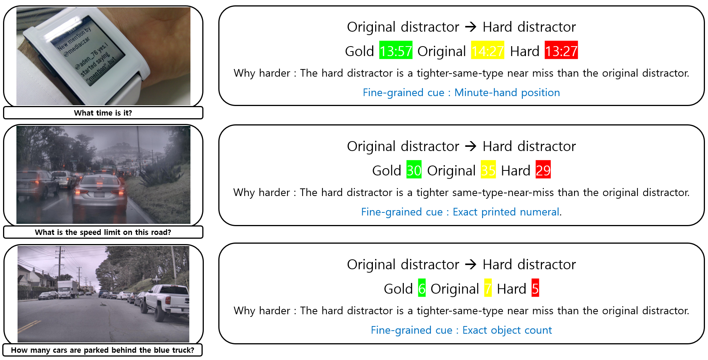

<!--
ANONYMOUS README
This README is for double-blind review.
Author information will be added upon de-anonymization.
-->

# Grounded Distractor Protocol (GDP): Diagnosing Model-Dependent Intervention Effects under Hard Distractors in MCQ-Based Vision-Language Model Evaluation

by Seunghun Oh, Unsang Park

This is the official implementation of **Grounded Distractor Protocol (GDP)**, a *matched three-condition diagnostic protocol* that evaluates how vision-language models respond to **same-type, visually plausible hard distractors** under controlled prompting interventions.

---

### Overview

<p align="center">
  
</p>

Multiple-choice evaluation for vision-language models (VLMs) increasingly relies on stronger distractors, but a single accuracy score cannot distinguish whether models truly use **fine-grained visual evidence** or rely on coarse cues.

**GDP** instantiates a matched (original, permutation-control, hard-distractor) protocol over a manually reviewed **98-item diagnostic slice (GDP-Slice)** and probes evidence-first prompting as a **controlled diagnostic intervention**—not a new prompting method.

We find that the same evidence-first intervention is **not universally beneficial**: LLaVA-style models improve, while Qwen2.5-VL and InternVL2.5 show **opposite, negative effects**. Answer-first controls further suggest the model-dependent effects reflect **different intervention mechanisms**, not just performance.

---

### Status

🚧 **This repository is under construction.** Code, GDP-Slice dataset, and prompt templates will be released upon publication.

Planned contents:
- [ ] GDP-Slice: 98-item diagnostic slice with hard distractors
- [ ] Prompt templates (direct, evidence-first, answer-first)
- [ ] Inference scripts for 4 evaluated VLMs
- [ ] Metric computation (HSIG, ΔHDsel, McNemar tests, bootstrap CIs)
- [ ] Reproduction scripts

---

### Installation

<!--
```bash
conda create -n gdp python=3.10
conda activate gdp
git clone <>
cd <>
pip install -r requirements.txt
```
-->
---

### Method

---

### Acknowledgement

Will be added upon de-anonymization.

---

### Questions?

If you have any questions, feel free to email Seunghun (gnsgus190@sogang.ac.kr).

---


### Citation

---

```bibtex
@inproceedings{anonymous2026gdp,
  title={Grounded Distractor Protocol: Diagnosing Model-Dependent Intervention Effects under Hard Distractors in MCQ-Based Vision-Language Model Evaluation},
  author={Anonymous Authors},
  booktitle={Proceedings of the 35th ACM International Conference on Information and Knowledge Management (CIKM)},
  year={2026},
  note={Under review}
}
```
